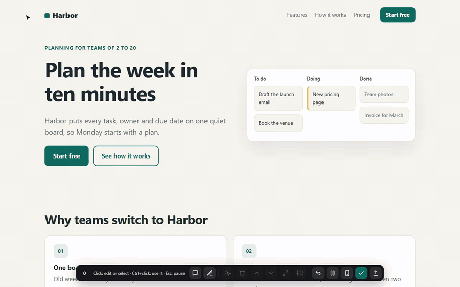
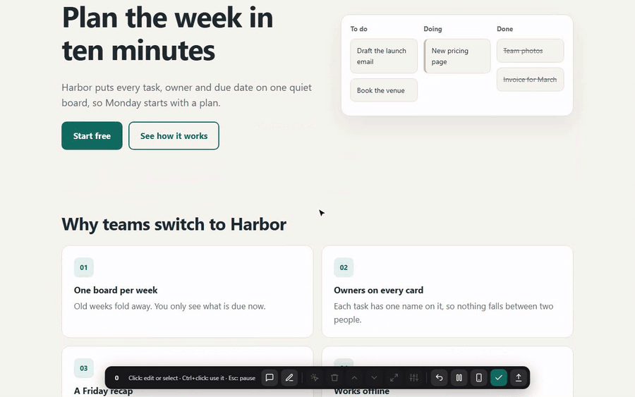
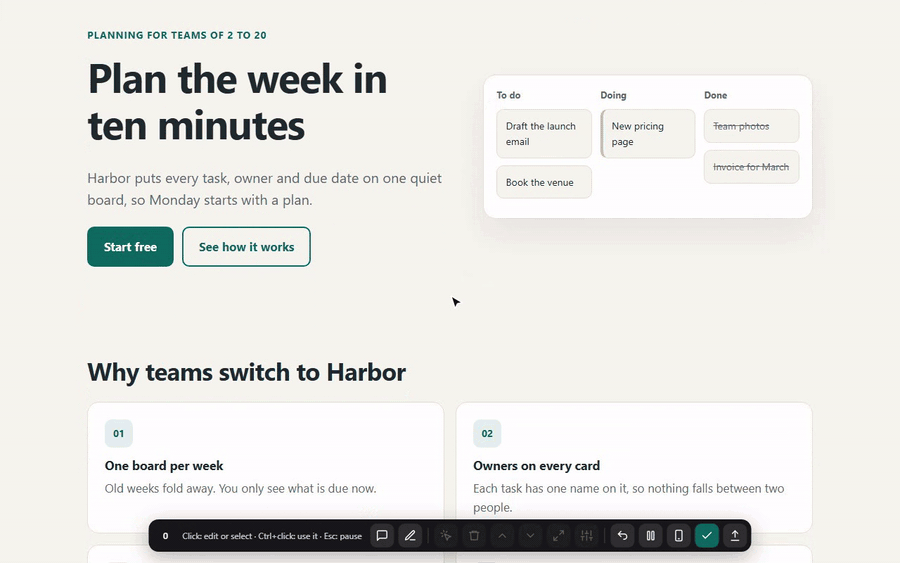
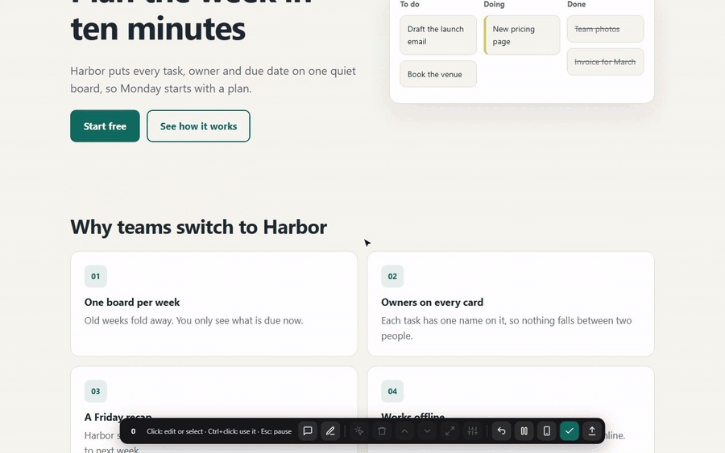
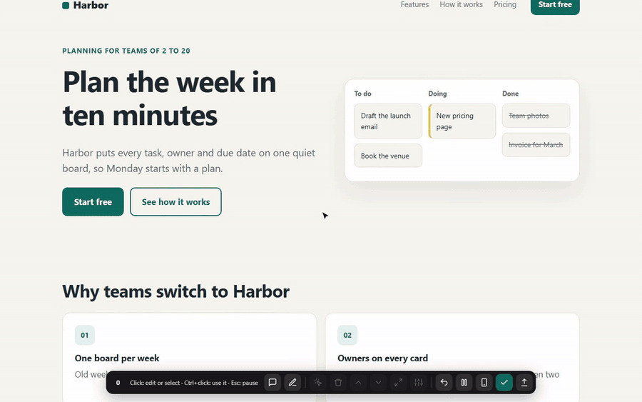
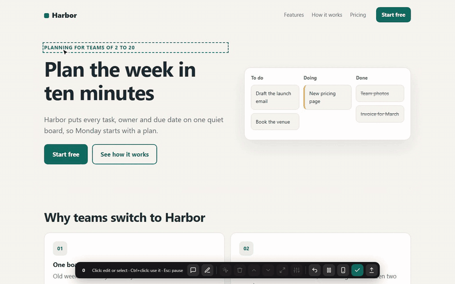
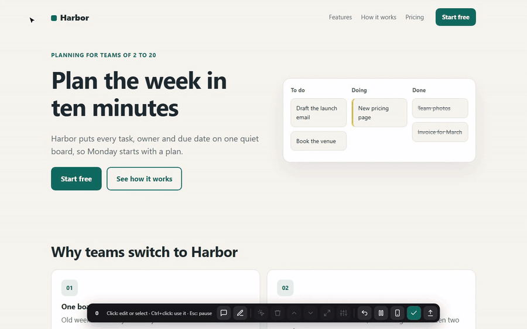

# clickedit



**Click your local site to change it. Your AI coding agent makes the same changes in the code.**

```sh
npx skills add barragain/clickedit --copy
```

Then tell your AI "open clickedit on my site". It starts clickedit and gives you an address. Open it, click any words and type. Press Save when you are done. Works with Claude Code, Codex and other coding agents, on any framework that runs a local dev server.

---

## How does my AI get the changes?

Every Save writes a short text file to `.clickedit/` in your project. Your AI reads it and edits the source.

1. Your AI starts your dev server and clickedit, and tells you the address to open.
2. Your AI runs clickedit's wait in the background. It waits for your next Save.
3. You edit the page and press Save.
4. The wait ends and prints the list of changes. Your AI applies each one in the code.
5. Your AI marks the save applied. The status above the bar goes from "1 waiting for your AI" to "Your AI is applying..." to "All applied, waiting to go live".
   After you press Publish it shows "Going live...", then "Live on the site" once your AI has checked the live page.
6. Your AI starts the wait again, ready for the next round.

A save looks like this:

```md
# Edits for http://localhost:4300/
Saved 2026-11-07T13:51:07.361Z, viewport 1280x800

1. TEXT at `section.hero > div.hero-copy > h1` ("Plan the week in ten minutes")
   before: "Plan the week in ten minutes"
   after:  "Plan the week in five minutes"
2. COMMENT on `section.hero > div.board` ("To do Draft the launch email Book the venue..."): Use a real screenshot of the app here
3. CIRCLE around `section#pricing > div.plans > article.plan.plan-main` ("Team $6 per person a month..."): Make this card taller so it stands out
```

Circles and arrows are saved as the elements they cover, so your AI reads them as text. It never needs to look at a picture.

### Set up your AI

```sh
npx skills add barragain/clickedit --copy
```

Run it in your project, in a normal terminal. It installs the clickedit skill, with the tool inside it, for Claude Code, Codex and the other agents you pick. `--copy` gives each agent its own copy, so removing one agent's folder never breaks another. Add `-g` to have it in every project. The installer needs Node 22.20 or newer; clickedit itself runs on Node 18. In the Codex app, its sandbox blocks the download from GitHub (it shows up as a sign-in error, but no sign-in is needed). Either run the install line in a terminal, or tell Codex "run npx skills add barragain/clickedit --copy outside the sandbox with internet access" and approve when it asks. Start a new session of your AI so it loads the skill, then say "open clickedit on my site" or "edit my site with clickedit".

Without the installer: run `npx github:barragain/clickedit --proxy <your dev address>` yourself, and give your AI the loop. For Codex and other agents, paste the section in [`AGENTS.md`](AGENTS.md) into your project's `AGENTS.md`.

Add `.clickedit/` to your `.gitignore`. Saves are notes for your AI, not code.

---

## Edit text


Click any words to type over them. Buttons and links work too. Ctrl+B and Ctrl+I make words bold or italic. Changed text gets a yellow tint until your AI applies it.

## Comment



Comments are for what you can't change by typing: layout, images, spacing, size. Right-click the thing and write what you want, like "put all four cards in one row". The comment stays on the page as a pin. Click the pin to edit or delete it. To change words, just type over them.

## Draw circles and arrows



Press the pen button, or hold Shift, and drag. A loop becomes "CIRCLE around" the elements inside it. A straight stroke becomes "ARROW from X to Y". Add a note to either one, like "make this card taller" or "move this quote below the plans".

## Drag to reorder



Press any block and drag it among its neighbours. While you type in a block, drag its outline instead, so dragging inside the words still selects them. The bar also has buttons to move the selection up or down, remove it, or select the bigger block around it.

## Style tweaks



Select a block and open the style panel. Change padding, margin, text size, text colour and background. The page updates as you go, and the save lists each value before and after.

## Phone view



The phone button shows the page in a 390px frame. Everything works inside it. Saves made there are marked as edits for the mobile layout.

## Publish



Publish asks your AI to apply every pending save and deploy the site. It covers every page you saved since the last publish. It warns you first about changes you have not saved and saves your AI has not applied yet.

### Also in the toolbar

The toolbar takes its font and main colour from your site, and picks light or dark to match. Undo steps back one change at a time. Unsaved edits survive a reload or a closed tab. Pause (or Esc) lets you use the page like a visitor.

MP4 versions of every clip are in [`media/`](media).

---

## Keyboard and mouse

| Action | Does |
|---|---|
| Click | Edit the words, or select the block |
| Ctrl+click (Cmd+click on Mac) | Use the button or link like a visitor |
| Right-click | Select and comment |
| Shift+drag | Draw a circle or an arrow |
| Press and drag a block | Move it among its neighbours |
| Delete or Backspace | Remove the selected block (while typing, it deletes letters as usual) |
| Ctrl+B, Ctrl+I | Bold, italic, while typing |
| Ctrl+Enter | Add the comment you are typing |
| Esc | Stop typing, then clear the selection, then turn off a tool, then pause |

## Options

```sh
npx github:barragain/clickedit --proxy http://localhost:3000   # serve your dev site with the toolbar added
npx github:barragain/clickedit                                 # save server only, for the script tag
npx github:barragain/clickedit --wait                          # wait for the next save or publish request, print it, exit
npx github:barragain/clickedit --next                          # print the oldest save not applied yet, without waiting
npx github:barragain/clickedit --applied                       # mark saves applied up to the one --wait printed
```

| Option | Default |
|---|---|
| `--proxy <url>` | none |
| `--proxy-port <n>` | 4300 |
| `--port <n>` (save server) | 4399 |
| `--out <dir>` | `.clickedit` |

### Script tag instead of the proxy

If you would rather open your dev site directly, run `npx github:barragain/clickedit` and add this tag to your layout, in development only:

```html
<script src="http://localhost:4399/clickedit.js" defer></script>
```

Put it behind your framework's development check, such as `import.meta.env.DEV` or `process.env.NODE_ENV === 'development'`, so it never ships to production.

---

## FAQ

**Which frameworks does it work with?**
Any site with a local dev server, whatever framework or language builds it, plain HTML included. The proxy adds the toolbar to every HTML page and passes everything else through as it is. Hot reload keeps working, because websockets go straight to your dev server.

**Which AI agents?**
Claude Code, Codex and other coding agents. Anything that can run a command in the background and read a file can follow the loop.

**Is anything sent online?**
No. clickedit runs on your computer and writes files to your project folder. It makes no outside requests and has no analytics. The servers listen on 127.0.0.1 and only accept saves from local pages.

**Does it change my code?**
No. clickedit only writes to `.clickedit/`. Your AI makes the code changes, so you see them in your usual diff.

**My dev site runs on a custom hostname.**
Use the proxy. The page then loads from `localhost`, which clickedit accepts.

**Do I have to tell my AI when I save?**
In Claude Code, no: it picks up each save as you press Save. Codex is not woken by background commands, so after saving, say "saved" in the Codex chat.

**clickedit shows another project's page.**
Another site was already running on that port. clickedit warns when the page's text is not in your project's files, and your AI then starts your own dev server and opens clickedit on it. Saves made on another project's page are never applied.

**Does it need any packages?**
No. It runs on Node 18 or newer with no dependencies.

---

## Contributing

Issues and pull requests are welcome.

```sh
git clone https://github.com/barragain/clickedit
cd clickedit
npm test                                         # node:test, no install needed
npm run demo                                     # demo site on http://localhost:3000
node skills/clickedit/scripts/clickedit.mjs --proxy http://localhost:3000
```

The skill is [`skills/clickedit/SKILL.md`](skills/clickedit/SKILL.md) and the tool lives next to it in `scripts/`. The toolbar is one file, [`clickedit.js`](skills/clickedit/scripts/clickedit.js). The save server is [`server.mjs`](skills/clickedit/scripts/server.mjs) and the proxy is [`proxy.mjs`](skills/clickedit/scripts/proxy.mjs). `npm run media` records the clips in this README. It needs Playwright and ffmpeg, which are not dependencies.

## License

[MIT](LICENSE)

---

Made by [Matias Barragan](https://barragan.com.py) from [The Kit Room](https://thekitroom.co).
